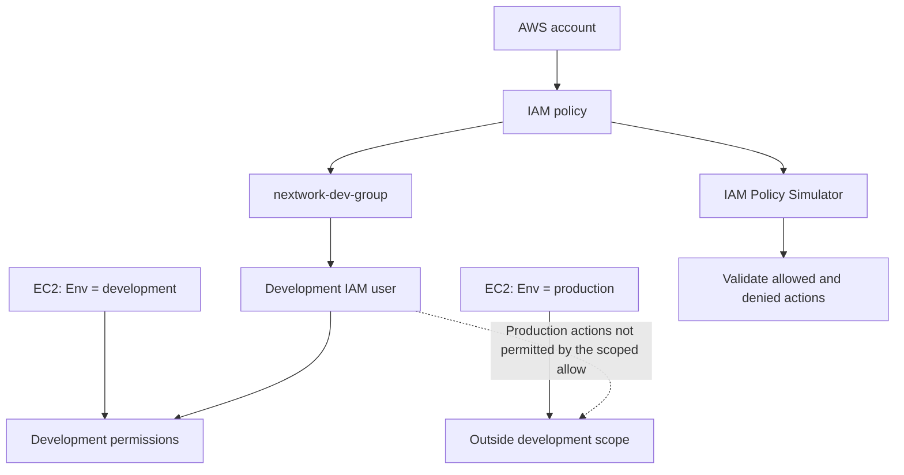

# AWS Cloud Security: Identity and Access Management (IAM)

A hands-on AWS project demonstrating how to organize identities and apply resource-scoped permissions with **AWS Identity and Access Management (IAM)** and **Amazon EC2**.

**Author:** Ephraim Nenyi Bondzie-Quaye  
**Project walkthrough:** [NextWork project page](https://nextwork.ai/projects/51a5fd24-7458-58a6-8653-9b90119a0e4a)  
**Detailed report:** [`docs/aws-iam-project-report-redacted.pdf`](docs/aws-iam-project-report-redacted.pdf)

> This is a learning project completed in a personal AWS environment. It is not presented as a production deployment or a formal security audit. The attached report has been sanitized to remove account and resource identifiers.

## Project objective

Configure access so that a development user can work with development EC2 resources without being able to stop an EC2 instance tagged as production. The project explores how IAM identities, groups, policies, resource tags, and policy simulation work together to support least-privilege access.

## Architecture and access model



The EC2 instances were tagged with an `Env` key and environment values of `development` and `production`. A custom JSON policy was attached to the development IAM group. The policy used the environment tag to scope the development permissions and included restrictions on tag-management actions.

## AWS services and concepts

| Service / concept | How it was used |
|---|---|
| AWS IAM | Created IAM users, a user group, an account alias, and a custom permissions policy |
| Amazon EC2 | Created development and production test instances |
| EC2 resource tags | Used `Env=development` and `Env=production` to distinguish environments |
| IAM JSON policies | Defined allowed and denied EC2 actions and resource conditions |
| IAM Policy Simulator | Tested permission decisions without repeatedly performing actions on live resources |

## Implementation

1. **Created EC2 environments** — Launched two EC2 instances to represent development and production.
2. **Tagged the instances** — Applied the `Env` tag with the values `development` and `production`.
3. **Defined an IAM policy** — Created a JSON policy intended to scope development access using the EC2 resource tag, allow instance-description visibility, and restrict tag creation/deletion actions.
4. **Created an IAM group and user** — Created a development group, attached the policy to it, and added a test IAM user.
5. **Tested access as the IAM user** — Signed in as the test user and checked access to the two EC2 environments.
6. **Used the IAM Policy Simulator** — Simulated EC2 actions to review the resulting allow/deny decisions.

## Validation and observed results

| Test | Observed result | What it demonstrated |
|---|---|---|
| Stop the production EC2 instance as the development user | **Denied** | The development-scoped permissions did not authorize stopping the production instance |
| Stop the development EC2 instance as the development user | **Allowed** | The user could perform the tested action on the development instance |
| Simulate `ec2:StopInstances` for the development group and a development resource | **Allowed** after correcting the resource/tag scope | The policy simulator helped identify and validate the resource scope |
| Simulate `ec2:DeleteTags` | **Denied** | The tested tag-deletion action remained restricted |

These are the outcomes recorded during this project. They describe the specific actions tested, not an exhaustive verification of every EC2 API action or every possible IAM evaluation scenario.

## Key learning outcomes

- Distinguished authentication (who can sign in) from authorization (what an identity can do).
- Created IAM users and groups and attached permissions at the group level.
- Read and worked with multi-statement JSON IAM policies, including `Effect`, `Action`, `Resource`, and `Condition`.
- Used EC2 resource tags as part of permission scoping.
- Tested access boundaries by comparing development and production resources.
- Used the IAM Policy Simulator to investigate permission decisions before relying on live resource actions.

## Repository contents

```text
aws-iam-cloud-security/
├── README.md
├── .gitignore
└── docs/
    └── aws-iam-project-report-redacted.pdf
```

## Security and scope notes

- The PDF included here is a sanitized copy. Account IDs, account sign-in aliases, IAM sign-in details, and EC2 resource identifiers visible in the original screenshots have been redacted.
- No access keys, secret keys, passwords, session tokens, or AWS credential files belong in this repository.
- The project used an IAM user as a learning exercise. For production workloads, prefer temporary credentials and IAM roles/federation where appropriate rather than creating long-lived IAM users.
- Review a policy's full effective permissions before using it in a real environment. IAM evaluation can involve identity policies, resource policies, permissions boundaries, SCPs, explicit denies, and action-specific condition-key support.
- The policy was exercised through selected console actions and simulator tests; it was not independently audited.

## Further improvements

Possible next steps for extending this project:

- Rework the exercise around IAM roles and temporary credentials.
- Add a least-privilege policy review using IAM Access Analyzer.
- Add repeatable policy tests and document additional allowed/denied EC2 actions.
- Create an architecture diagram showing the identity, group, policy, and resource relationships.

---

*Built as part of my ongoing learning journey in AWS cloud security and identity and access management.*
